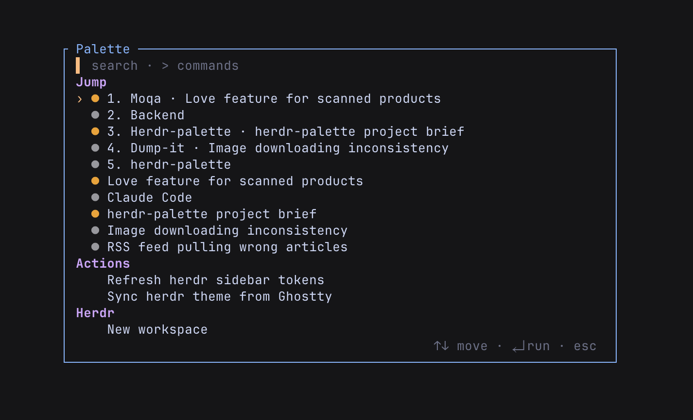
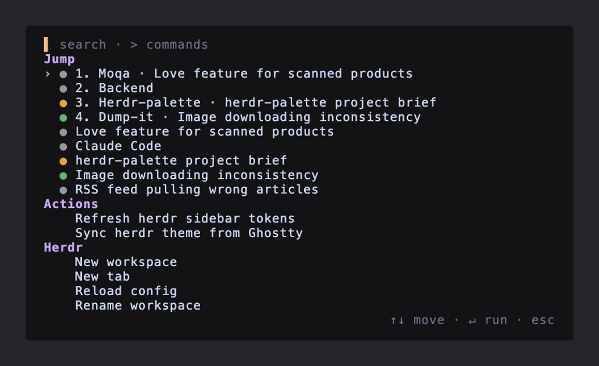

# herdr-palette

A command palette for [Herdr](https://herdr.dev). It opens in a centered
popup pane. Type to filter. Press Enter to run. 🐑





The palette shows four groups:

1. **Sessions** — Herdr sessions; an orange dot marks the current
   one. Enter switches the window to that session. See [Sessions](#sessions).
2. **Actions** — actions from all installed Herdr plugins.
   Enter invokes the action.
3. **Herdr** — built-in commands: new workspace, new tab, rename
   workspace, rename tab, reload config, phone mode.
4. **Jump** — Herdr workspaces and agents, with live status dots.
   Enter focuses the selection. When an agent waits for input, the
   group starts with a "Next blocked agent" entry.

Typed text also becomes a name: typing `Upvotecast` offers
`Rename workspace "Upvotecast"`, `Rename tab "Upvotecast"`,
`New workspace "Upvotecast"`, `New tab "Upvotecast"` and
`New session "Upvotecast"`, below the regular matches.

## Requirements

- Herdr 0.8.0 or later.

The install step downloads one prebuilt static binary from GitHub
Releases and verifies its checksum. No toolchain is needed. Prebuilt
platforms: macOS and Linux, arm64 and amd64.

## Install

```sh
herdr plugin install Binb1/herdr-palette
```

Then add a keybinding to `~/.config/herdr/config.toml`:

```toml
[[keys.command]]
key = "prefix+f"
type = "plugin_action"
command = "binb1.palette.open"
description = "Command palette"
```

Reload the config:

```sh
herdr server reload-config
```

Press `prefix+f` inside a Herdr session to toggle the palette. The
action opens the palette when it is closed. It closes the palette when
it is open.

Optional: bind `Cmd+P` directly. This needs a terminal that forwards
the cmd key, such as Ghostty:

```toml
[[keys.command]]
key = "cmd+p"
type = "plugin_action"
command = "binb1.palette.open"
description = "Command palette"
```

### Remote servers and VMs

Herdr installs plugins per machine, and never copies them to SSH
hosts. When you drive a remote server — `herdr --remote host`, or a
machine saved with `herdr machine add` — your local keybindings and
theme still apply, but plugin actions and panes are served by the
machine that hosts the session.

So if the palette is installed only on your laptop, the
`binb1.palette.open` action does not exist on the remote server and
the keybinding does nothing there. Install it on the server too:

```sh
ssh host 'herdr plugin install Binb1/herdr-palette'
```

Repeat for every saved machine. The remote host needs Herdr 0.8.0 or
later (`min_herdr_version`). Installing on the client alone covers
Local workspaces only.

## Keys

| Key | Effect |
|---|---|
| type | Filter the list (fuzzy match) |
| `>` | Filter commands only (Actions and Herdr groups) |
| `@` | Filter sessions only |
| `↑` `↓` | Move the selection |
| `Enter` | Run the selected entry |
| `Esc` | Close the palette |

The mouse also works. Click an entry to run it. Scroll to move the
selection.

## Theme

The palette reads the Herdr theme from `~/.config/herdr/config.toml`:
Catppuccin Mocha for dark and Latte for light, plus the color overrides
in `[theme.custom]`, `[theme.custom.dark]` and `[theme.custom.light]`
(`text`, `overlay0`, `mauve`, `peach`, `red`, `green`, `accent`). Other
base themes fall back to Catppuccin.

## Status dots

Each Jump entry shows the agent status as a colored dot:

- 🟠 `working` — the agent runs a task (an animated `⠋⠙⠹…` spinner)
- 🔴 `blocked` — the agent waits for input (the dot pulses `●`/`○`)
- 🟢 `done` — the agent finished
- ⚪ `idle` — no active task

(The palette renders small colored dots, not emoji.) The statuses
refresh every second while the palette is open.

## Sessions

Named Herdr sessions keep contexts apart: a session for a client shows
none of the workspaces or agents of your other sessions. The Sessions
group lists every session; an orange dot marks the current one.
Enter switches the current window to that session. "New session…"
asks for a name and switches to a new session. "Kill current session" stops
and deletes the session you are in, with all its panes, after a second
Enter; the window returns to the shell. (`default` is only stopped.)

Herdr cannot move a client to another session, so start Herdr through
the palette's wrapper:

```sh
"$PLUGIN_ROOT/bin/herdr-palette" attach work   # instead of: herdr --session work
```

`PLUGIN_ROOT` is the `plugin_root` that `herdr plugin list --json`
prints. A shell function keeps it short:

```sh
h() { /path/to/plugin/bin/herdr-palette attach "${1:-default}" }
```

To route plain `herdr` and `herdr --session X` through the wrapper
too, so every window can switch, add this zsh function as well:

```sh
herdr() {
  if (( $# == 0 )); then h default
  elif [[ $1 == --session && $# == 2 ]]; then h "$2"
  elif [[ $1 == session && $2 == attach && $# == 3 ]]; then h "$3"
  else command herdr "$@"
  fi
}
```

The wrapper runs the Herdr client in a loop. To switch, the palette
detaches the client (the session keeps running) and the wrapper
attaches to the target. A plain detach (`prefix+q`) still returns to
the shell.

Notes:

- A client started with plain `herdr` cannot switch. The palette says
  so in its footer.
- When two windows show the same session, both switch.
- Stopped sessions are listed too. Switching to one starts it.

## Phone mode

"Phone mode" flattens the layout for a narrow client, such as a phone
attached over SSH or mosh. Every pane in a split tab moves to its own
tab, so each pane gets the full width. "Exit phone mode" moves every
pane back and restores the splits.

Phone mode is also automatic. When a client makes the layout narrower
than 60 columns, the plugin engages phone mode. When the layout is
wide again, the plugin restores the splits. The automatic exit only
undoes an automatic entry: a manual "Phone mode" stays until a manual
"Exit phone mode".

The automatic exit needs the layout to grow wide again. A mosh client
stays attached when the phone app is backgrounded, so the layout stays
narrow until the phone session ends. Herdr also sizes a shared session
to its smallest client, so a phone and a desktop attached together
both see the phone width. To restore the splits on the desktop while
the phone is still attached, run "Exit phone mode" (or the toggle
action). A manual exit is remembered, so the automatic hook does not
re-engage until the layout goes wide again.

The `binb1.palette.phone` action toggles phone mode. Bind it to a key,
or invoke it with `herdr plugin action invoke binb1.palette.phone`.

Notes:

- Two-pane splits restore exactly. Deeper nested splits restore with
  the right panes in the right tabs, but the geometry can differ.
- A pane closed during phone mode is skipped on restore.
- The state lives in one JSON file in the plugin state directory. The
  palette shows "Exit phone mode" while that file exists.

## Development

A local checkout needs Go 1.21 or later:

```sh
go build -o bin/herdr-palette .
herdr plugin link .
herdr plugin action invoke binb1.palette.open
```

`herdr plugin log list --plugin binb1.palette` shows process logs.
`vhs demo.tape` re-records the README GIF.

Releases: bump `version` in `herdr-plugin.toml`, merge, then push the
matching tag (`vX.Y.Z`). GitHub Actions runs goreleaser and publishes
the binaries the install step downloads.

## Limits

Herdr 0.8.2 does not expose detach or sidebar commands over its socket
API. The Herdr group omits them.

## License

MIT
